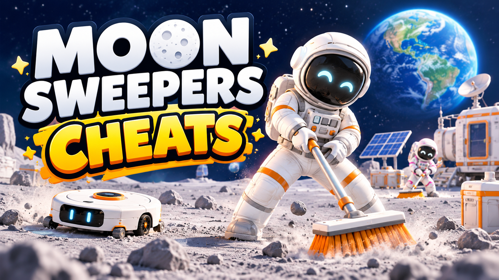

# Moon Sweepers — Cheats

**Dust contrast outlines, collection radius, payout multipliers, free depots, infinite fuel, every tool and vehicle unlocked — and an honest answer to the grind.**

    

> **[⬇️ Download the latest Moon Sweepers cheats](../../releases/latest)**

    

[The 71% question](#the-71-question) · [The grind curve](#the-grind-curve) · [Settings](#settings) · [Questions](#questions)

---

## The 71% question

Moon Sweepers sits at **71% positive across 478 reviews**. Not bad, not great — and the split is unusually informative, because the people who love it and the people who bounced off it are describing *the same game at different hours*.

The praise is for the first evening: the toothbrush gag lands, the moon is quiet and strange, low gravity makes hauling genuinely pleasant, and the first time a shipment pays out and you buy something that is not a toothbrush is a real moment.

The complaints are almost all about hour six onward, and they cluster:

- Dust is grey, on grey regolith, under grey light. Finding the last patches in a cleared sector is eye strain, not gameplay.
- The gap between tool tiers widens faster than payouts do.
- Depot placement is the smartest system in the game, and you spend most of your time walking to one anyway.

That is a tuning problem, not a design failure, and almost every setting on this page exists to answer one of those three complaints specifically. If you refunded this game at hour seven, the honest pitch is that **three settings** probably fix the thing that made you refund it. They are named below.

## The grind curve

Rather than a feature list, here is when each thing starts to matter.

| Where you are | What the game is asking | What actually helps |
|---|---|---|
| **Hour 1** — toothbrush | Nothing. This part is good. | Nothing. Play it. |
| **Hour 2–4** — first upgrades | Learning depot placement, first vehicle | Dust contrast outlines, if your eyes are struggling |
| **Hour 5–8** — the wall | Same sectors, slower payouts | Payout multiplier `3x`, collection radius `2x` |
| **Hour 9–15** — fleet | Managing vehicles and depot spacing | Infinite fuel, free depots, instant shipments |
| **Hour 16+** — completion | Hunting the last 2% of a sector | Reveal uncleaned areas, auto-collect in radius |
| **Any hour, co-op** | Keeping 16 people from colliding | Teleport to teammate, task highlighting |

The three settings worth naming for anyone who bounced: **dust contrast outlines**, **payout multiplier at 3x**, **collection radius at 2x**. That is the hour-five wall removed without removing the job.

## Settings

### Readability

Grey dust on grey ground is the most-cited complaint in the reviews and the easiest thing on this page to justify.

| Setting | Scope |
|---|---|
| Dust contrast outlines | Client |
| Outline style — edge, fill, dot | Client |
| Uncleaned-area shading on the map | Client |
| Depot and shipment markers through terrain | Client |
| Brightness `100%`–`250%` | Client |
| Reduce lens flare and bloom | Client |
| Interface scale `75%`–`200%` | Client |

None of it collects anything for you. It makes the thing you are looking for visible against the thing it is sitting on.

### Sweeper

| Setting | Key | Scope |
|---|---|---|
| Infinite oxygen | <kbd>F1</kbd> | Client |
| Infinite stamina | <kbd>F2</kbd> | Client |
| Carry capacity `1x`–`50x` | slider | Client |
| Collection radius `1x`–`10x` | slider | Client |
| Collection speed `1x`–`20x` | slider | Client |
| Movement speed `1x`–`6x` | slider | Client |
| Jump height `1x`–`8x` | slider | Client — it is a moon, after all |
| No suit damage | — | Client |
| Auto-collect within radius | <kbd>F3</kbd> | Client, `bypass` — off by default |

### Dust and shipments

| Setting | Key | Scope |
|---|---|---|
| Dust value multiplier `1x`–`50x` | slider | **`crew`** |
| Shipment payout multiplier `1x`–`50x` | slider | **`crew`** |
| Instant shipment launch | <kbd>F4</kbd> | **`crew`** |
| Infinite money | <kbd>F5</kbd> | **`crew`** — shared crew funds |
| Free depot placement | <kbd>F6</kbd> | **`crew`** |
| Unlimited depots | — | **`crew`** |
| Depot collection range `1x`–`20x` | slider | **`crew`** |
| Reveal uncleaned areas | <kbd>F7</kbd> | Client |
| Dust respawn rate `0x`–`5x` | slider | **`crew`** — zero means cleaned stays cleaned |

Money and payouts are `crew` because the funds are shared. Setting the multiplier to 50x in somebody else's lobby ends their progression curve, not just yours.

### Fleet

| Setting | Key | Scope |
|---|---|---|
| Unlock all cleaning vehicles | — | `save` |
| Infinite fuel | <kbd>F8</kbd> | Client |
| Vehicle capacity `1x`–`20x` | slider | Client |
| Vehicle speed `1x`–`5x` | slider | Client |
| No vehicle damage | — | Client |
| Never flip or get stuck | — | Client |
| Recall vehicle to you | <kbd>F9</kbd> | Client |
| Low-gravity multiplier `0.1x`–`3x` | slider | **`crew`** — physics for everyone |

### Progression

| Setting | Scope |
|---|---|
| Unlock all tools | `save` — the toothbrush is optional |
| All upgrades free | **`crew`** |
| Upgrade cost `0%`–`100%` | **`crew`** |
| Unlock all sectors | `save` |
| Sector completion `0%`–`100%` | **`crew`**, `save` |
| Unlock all cosmetics | `save` |

### Crew

| Setting | Key | Scope |
|---|---|---|
| Teleport to a teammate | <kbd>F10</kbd> | Client |
| See teammates through terrain | — | Client |
| Task highlighting — who is on what sector | — | Client |
| Recall a teammate's stuck vehicle | — | **`crew`** — the generous one |
| Lobby size `1`–`16` | slider | **`crew`** |

Host-only mode ships enabled and blocks `crew` settings while you are a guest. In a sixteen-person lobby, assume somebody is there for the quiet.

### Display

Free camera <kbd>F11</kbd>, hide interface <kbd>F12</kbd>, field of view `60`–`120 deg`, **Earth position in the sky**, sun angle, disable motion blur, screenshot mode. Plus host-only mode, rolling save backup, read-only mode, achievement blocking, rebindable menu key.

Moving Earth around the sky is pure photo-mode indulgence and it costs nothing. The moon is the most photogenic thing about this game.

## Keys

<kbd>Insert</kbd> menu · <kbd>End</kbd> reset all · <kbd>F1</kbd> oxygen · <kbd>F2</kbd> stamina · <kbd>F3</kbd> auto-collect · <kbd>F4</kbd> instant shipment · <kbd>F5</kbd> money · <kbd>F6</kbd> free depots · <kbd>F7</kbd> reveal uncleaned · <kbd>F8</kbd> fuel · <kbd>F9</kbd> recall vehicle · <kbd>F10</kbd> teleport to teammate · <kbd>F11</kbd> free camera · <kbd>F12</kbd> hide HUD

Everything rebinds. Arrows and <kbd>Enter</kbd> navigate without a mouse.

## Two configurations

**The refund-saver:** dust contrast outlines, payout multiplier 3x, collection radius 2x. You still drive, still place depots, still decide which sector is worth the trip, still fill and launch every shipment. The hour-five wall is gone and the job is intact. If you are only going to use this page for one thing, use it for this.

**The one that ends it:** auto-collect plus the sector completion slider. Together they clean the moon without you. There is a version of that which is relaxing to watch and a version which is a waste of nine dollars, and only you know which one you are about to have.

Settings marked `save` rewrite persistent progression, and the sector completion slider cannot be undone short of a backup. The rolling backup runs on attach by default — leave it on.

## Questions

Can this get me in trouble?

There is nothing here to get in trouble with. No competitive mode, no leaderboards, no anti-cheat. Achievements fire locally and can be suppressed from the Display section if you would rather earn them properly.

I found the dust impossible to see. Does this fix that?

That is what the contrast outlines are for, and it is the most defensible setting on the page. Grey dust on grey regolith under grey lighting is a readability problem rather than a difficulty one, and outlining the dust does not collect a single grain for you.

I bounced off the grind. What do I turn on?

Payout multiplier at 3x and collection radius at 2x. Not infinite money — that removes the upgrade ladder entirely, and the ladder is the only progression this game has. A 3x multiplier roughly matches the pace of the first two hours, which is the part everybody liked.

Will my settings affect the other fifteen people?

Anything marked <code>crew</code> will. Funds are shared, depots are shared, and gravity is shared. Host-only mode blocks those for guests by default, and agreeing on a multiplier before you start is a two-minute conversation that avoids a longer one later.

Does it work with the Brick by Brick bundle version?

Yes. Buying the two games together on Steam gives you ordinary Steam copies of each, with the same app IDs and builds as buying them separately.

Several settings went dead after an update.

Memory addresses move whenever the game patches, and settings fail one at a time rather than together. Compare your build number against the release notes, or switch on read-only mode to see which values the menu can still read correctly.

My antivirus removed it.

Reading and writing another running program's memory is exactly what this does, and also what several unpleasant categories of software do, so scanners flag the whole class rather than judging each case. A checksum travels with every release and the source sits in this repository. Add an exclusion or decline to — both are defensible.

## When something misbehaves

Dust and depot settings bind to a loaded surface, not the main menu, so start or join a session before attaching. Vehicle settings bind to whatever you are currently driving — change vehicles and re-toggle. Collection radius above about 6x will pull dust through terrain, which looks wrong and occasionally confuses the sector completion counter.

If the menu will not open, something else claimed <kbd>Insert</kbd> — Steam's overlay and Discord between them account for nearly every case. If the frame rate drops with reveal-uncleaned-areas enabled, that is the game drawing an overlay across the whole sector; narrow it or toggle it only when you need it.

[Open an issue](../../issues) with the **game build number** first, then host or guest, which sector, and the single setting that failed.

## Version history

**1.0.0** — 25 October 2026 — first build, two days after launch. 40+ settings across Readability, Sweeper, Dust and shipments, Fleet, Progression, Crew and Display. Host-only mode and rolling backup on by default; auto-collect off by default.

---

Unofficial fan tool with no connection to DragDrop Games or Valve. Moon Sweepers and everything in it belongs to them — it is nine dollars from a small Finnish studio and worth supporting. Writing into a live process can crash it or damage a save, so keep backups. MIT licence.

